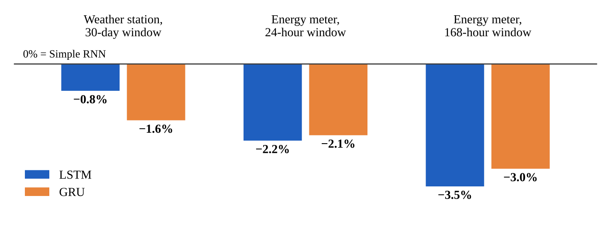

# RNN vs LSTM vs GRU for IoT Applications

Comparative study of three recurrent neural network cells — **Simple RNN**, **LSTM** and **GRU** — applied to three real IoT sensor datasets, measuring both accuracy and the edge-device cost of each model.

Course: Artificial Intelligence and IoT (CSDX 363), B.Tech CSE (IoT), B.S. Abdur Rahman Crescent Institute of Science & Technology
Team: Dwaragesh C (RRN 230191601009), Nataraj VK (RRN 230191601039)

Full report: [`report/RNN_LSTM_GRU_IoT_Comparative_Study.pdf`](report/RNN_LSTM_GRU_IoT_Comparative_Study.pdf)

## Experiments

| ID | IoT application | Dataset | Task | Window |
| --- | --- | --- | --- | --- |
| A | Smart energy metering | UCI Individual Household Electric Power Consumption | Forecast next-hour active power (kW) | 24 h |
| B | Weather station | Daily minimum temperatures, Melbourne 1981–1990 | Forecast next-day minimum temperature (°C) | 30 days |
| C | Smart-building occupancy | UCI Occupancy Detection | Classify room as occupied / empty | 30 min |
| D | Long-memory stress test | Same as A | Same as A | 168 h |

Every model: one recurrent layer (64 units) → Dense(1), Adam (lr 0.001), batch 64, up to 40 epochs with early stopping (patience 5). Each configuration is trained with 3 random seeds (10 for occupancy).

## Results

| Experiment | Metric | Simple RNN | LSTM | GRU |
| --- | --- | --- | --- | --- |
| A – Energy, 24 h | RMSE (kW) | 0.471 | **0.460** | 0.461 |
| B – Temperature, 30 days | RMSE (°C) | 2.259 | 2.241 | **2.222** |
| C – Occupancy, 30 min | Accuracy, mean (median) | 95.2 % (95.3 %) | 93.5 % (93.4 %) | **96.1 % (97.8 %)** |
| D – Energy, 168 h | RMSE (kW) | 0.474 | **0.457** | 0.460 |
| Cost (energy task) | Parameters | **4,801** | 19,009 | 14,465 |
| Cost (energy task) | Latency per window, 24 h | **0.16 ms** | 0.68 ms | 0.75 ms |



Gated cells (LSTM, GRU) are 0.8–3.5 % more accurate than a plain RNN on forecasting, at 3–4× the memory and compute; their advantage grows with the window length. Full per-model numbers (mean and standard deviation) are in [`results/results_summary.csv`](results/results_summary.csv); every individual run is in [`results/results.jsonl`](results/results.jsonl).

## Repository layout

```
iot_rnn_lstm_gru.py      data loading, models, training, evaluation (all experiments)
summarise.py             results/results.jsonl -> results/results_summary.csv
download_data.sh         fetches the three public datasets into data/
requirements.txt
results/
  results.jsonl          one line per training run (metrics, cost, validation curve)
  results_summary.csv    mean and std per experiment and model
  run_*.log              console output of the runs
outputs/
  chart_rmse.png/.svg    accuracy chart used in the report
  eq_*.svg               gate equations used in the report
report/
  RNN_LSTM_GRU_IoT_Comparative_Study.pdf
```

## How to run

```bash
pip install -r requirements.txt
bash download_data.sh                      # ~21 MB download, ~130 MB unpacked
KERAS_BACKEND=jax python3 iot_rnn_lstm_gru.py          # all experiments: B C A D
KERAS_BACKEND=jax python3 iot_rnn_lstm_gru.py A        # or a single experiment
SEEDS=0,1,2,3,4,5,6,7,8,9 KERAS_BACKEND=jax python3 iot_rnn_lstm_gru.py C   # more seeds
python3 summarise.py
```

New runs are appended to `results/results.jsonl`; delete it first for a fresh set. The script also runs on the `tensorflow` or `torch` Keras backends. The full set takes about 25 minutes on a 2-core CPU; no GPU is needed.

Inference latency is measured with a plain NumPy re-implementation of each trained network (one time step at a time, as on an edge device). The script asserts that it matches the Keras output before timing it.

## Data sources

- G. Hebrail and A. Berard, *Individual Household Electric Power Consumption*, UCI Machine Learning Repository, DOI 10.24432/C58K54 (CC BY 4.0).
- L. M. Candanedo and V. Feldheim, *Occupancy Detection*, UCI Machine Learning Repository; paper in *Energy and Buildings* 112 (2016).
- Australian Bureau of Meteorology, daily minimum temperatures, Melbourne 1981–1990, via [jbrownlee/Datasets](https://github.com/jbrownlee/Datasets).

The datasets are not stored in this repository; `download_data.sh` fetches them.
